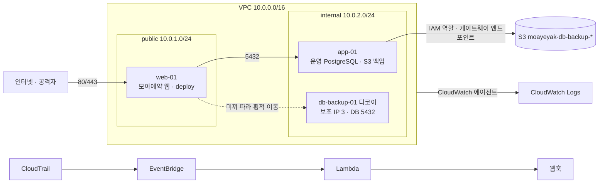

# 가상 회사 인프라 설계 (AWS)

작성: 2026-11-19 · 확정: 11/19(11/20 작업을 앞당김) · 구축: 11/21~22
변경: 11/19 OCI + AWS 혼합 → **AWS 단일 환경**으로 전환 (사유는 맨 아래)

## 1. 계정 · 비용
- 신규 AWS 계정, **Paid 플랜**(Free 플랜 대상 아님 — 11/19 확인, 크레딧 없이 실제 과금). 리전: 서울(ap-northeast-2)
  - 주의: Builder ID로 로그인하면 "새 가입 방식(프로젝트)" 화면이 열리고 리전이 연락처 기준(아시아는 시드니)으로 고정된 것처럼 보임 → root로 로그인하니 일반 콘솔에서 서울 사용 가능 확인(11/19)
  - 11/19 현재 **계정 확인 진행 중**(최대 2일, CloudShell 환경 생성 불가). 11/20 저녁까지 안 풀리면 11/21은 계정 없이 가능한 준비(웹 앱, auditd 규칙, 디코이 DB 탐지, Git 저장소)로 돌리고 구축은 11/22에 몰아서 진행
- 기본 설정 완료(11/19): Budgets 알림($10, $20), 루트 계정 MFA. root는 계정 관리용으로만 사용. (권장) Cost Anomaly Detection 활성화
- 예상 사용액(11/19 재계산, 추정): 인스턴스 약 $17 + **공인 IPv4 3개 약 $5**(IP당 시간당 $0.005) + EBS 약 $1 + 로그 소량 ≈ **약 $23** (실제 청구) → **11/21 재계산 약 $32**: web-01·app-01을 t3.small로(시간당 $0.013 → $0.026, 2대 × 약 14일 ≈ +$8.7). Budgets $20 알림은 넘는다(예상된 알림)
- 비용 절감: 작업하지 않는 밤에 web-01·app-01 중지 가능. 디코이는 uptime이 진정성 측정 항목이라 계속 켜 둠
- **NAT 게이트웨이 사용 금지**
- 12/4 보고서 게시 후 인스턴스 중지·정리 (필요한 것만 스냅샷)

## 2. 자원
| 호스트 | 가상 회사 내 역할 | 타입 | 서브넷 | 비고 |
|---|---|---|---|---|
| web-01 | 모아예약 웹 서비스 (의도적 취약점 1개 → 초기 침투 지점) | ~~t3.micro~~ → t3.small (2GB, 11/21) | public 10.0.1.0/24 | 80/443 내 공인 IP만 |
| app-01 | 내부 업무 서버 (운영 PostgreSQL, 실제 S3 백업 작업) | ~~t3.micro~~ → t3.small (2GB, 11/21) | internal 10.0.2.0/24 | IAM 역할 `backup-writer` 부착 |
| db-backup-01 | **디코이** — S3 전환 후 정리되지 않은 옛 DB 백업 서버, 실제 OS | t3.small (2GB) | internal 10.0.2.0/24 | 보조 사설 IP 최대 3개(단일 호스트 다중 주소) |

- **ENI 한도 확인(11/19, 콘솔)**: t3.small 최대 네트워크 인터페이스 3개, 인터페이스당 IPv4 4개 → 기본 ENI 하나로 주 IP + 보조 IP 3개 가능. 보조 사설 IP는 무료
- 진정성 검증의 비교 기준 서버: 본인 개인 서버(OCI, 장기 운영) — 읽기 전용 검사만 실행, 이 VPC와는 연결하지 않음

### 서버 구성 요소와 근거 (11/19)
판별 단서는 세 갈래 — ① 가상화 흔적(dmidecode, `/sys/class/dmi/id/sys_vendor`) ② 구현 차이(흉내 낸 프로토콜·서비스가 진짜와 다르게 응답: Vetterl & Clayton, "Bitter Harvest", USENIX WOOT 2018) ③ 사용 흔적 부족(Miramirkhani et al., "Spotless Sandboxes", IEEE S&P 2017; ATT&CK T1497.002)
- ①은 세 서버가 모두 EC2라 진짜 서버도 같은 값 → 디코이 전용 단서 아님
- ②를 피하려면 **역할 서비스는 진짜 소프트웨어**, 패치 수준도 다른 서버와 동일
- ③이 이 프로젝트의 핵심 작업 — 서사 시간표(운영 시작 → S3 전환)에 맞춰 사용 흔적 생성
- 원칙: 세 서버는 같은 베이스에서 출발하고 차이는 역할에서만 / 서버끼리 서로 아는 흔적(known_hosts, rsync 기록, 접속 이력)이 맞물려야 함

| 구분 | 구성 |
|---|---|
| 공통 베이스 | Ubuntu Server 24.04 LTS AMI(SSM 에이전트 기본 설치), CloudWatch 에이전트, auditd + 같은 규칙, unattended-upgrades, logrotate, cron, Asia/Seoul, 관리자 계정 |
| web-01 | nginx → gunicorn → Flask(모아예약: 랜딩·매장 목록·예약 폼·관리자 로그인·예약 확인서 PDF), systemd 유닛, `/srv/app` git 저장소(커밋 이력), `deploy` 계정, 쌓인 접근 로그, 앱이 실제로 app-01 DB에 연결. 웹 앱 작업 3시간 상한. 푸터에 "가상의 회사" 표기 |
| app-01 | PostgreSQL 16(운영 DB, 더미 매장·예약 데이터), `pg_dump` → S3 cron(IAM 역할), awscli, `[backup-legacy]` 흔적 |
| db-backup-01 | 진짜 OpenSSH, rsync 수신 설정, `backup` 계정, `/backup/dumps` 옛 덤프(전환 시점까지), 복원 검증용 DB 5432, 보조 IP 3개 |

- **결정(11/20)**: 디코이 5432는 Python 더미 리스너 대신 **진짜 PostgreSQL 16 + `log_connections`**. ②의 구현 차이 단서와 "디코이 전용 프로세스" 단서가 함께 사라짐
  - 미끼 계정(`report_ro`·`sync_svc`)은 디코이 PG에 만들지 않음 → 로그인은 실패하고, 서버 로그에 `password authentication failed for user "…"`가 남음(문서 원안대로, 범위 늘리지 않음)
  - 경보는 **모든 접속**(`connection received`부터)에 울림. 서버에는 미끼 계정 이름 목록을 두지 않고, 사용자명 → T1/T5 대응은 서버 밖(`detection/`)에서 함("접속 자체가 신호", 3절)
  - 같은 PG 로그 설정(`log_connections`·`log_disconnections`, CIS PostgreSQL Benchmark 권고 항목)을 app-01에도 적용(변경 A)
  - 대가: 여유 시 tar-pit은 리스너 코드 대신 PG contrib `auth_delay`로. 메모리는 11/22 부하 테스트에서 확인
- **지울 수 없는 단서 후보**: cloud-init 로그(`/var/log/cloud-init.log`, `/var/lib/cloud`)의 최초 부팅 날짜(11/21~22). 세 서버 공통이라 디코이 전용은 아니지만 "오래 쓴 백업 서버" 서사와 충돌 → 기능 1에서 확인, 안 되면 한계로 기록

### 구성도 (초안)

## 3. 네트워크
- VPC 10.0.0.0/16, 서브넷 2개(public / internal), 인터넷 게이트웨이 1개
- **내부 서버의 외부 통신(패키지 업데이트, 웹훅 송신)**: NAT 게이트웨이 대신 공인 IPv4를 붙이고 **보안 그룹에서 인터넷 인바운드를 전부 차단**(아웃바운드만 허용)
  - 한계로 기록: 실제 회사라면 NAT를 쓰는 구조. 비용 때문에 보안 그룹으로 격리를 대신함
- S3 접근: **S3 게이트웨이 엔드포인트**(무료)
- 관리 접속: **SSM Session Manager**
- 경보를 web-01 경유로 보내는 방식은 제외 — web-01은 시나리오상 먼저 장악되는 호스트

### 보안 그룹
| 대상 | 인바운드 | 비고 |
|---|---|---|
| web-01 | 80/443 ← **내 공인 IP만** | 의도적 RCE가 있는 호스트를 인터넷에 열지 않음(서사상 "외부 공개 웹 서비스"는 유지, 보고서 한계에 기록). 공개 노출 실험(12/2 저녁~) 때만 개방. 관리 접속은 SSM |
| app-01 | 22, 5432 ← 10.0.0.0/16 만 | 웹 → 내부 DB 통신은 실제 회사처럼 허용 |
| db-backup-01 | 모든 포트 ← 10.0.0.0/16 만 | 정상 업무에서 아무도 접속하지 않는 서버 → 접속 자체가 신호 |

## 4. 회사 서사 (확정 11/19)
**모아예약(가상의 회사) — 소규모 매장 예약 관리 SaaS. "백업을 서버에서 S3로 옮긴 뒤 옛 서버와 옛 키를 정리하지 않은 회사"**
- 실존 서비스와 이름 겹침 없음(11/19 검색). 보고서에 "가상의 회사" 명시
- 이름 규칙: 버킷 `moayeyak-db-backup-<난수 6자리>`, 웹 앱 계정 `deploy`, 디코이 미끼 계정 `backup`, 미끼 DB 계정 `report_ro`·`sync_svc`, 옛 IAM 사용자 `backup-legacy`, 현재 IAM 역할 `backup-writer`
- **과거**: app-01이 매일 DB 덤프를 db-backup-01로 rsync, S3 업로드는 IAM 사용자 `backup-legacy`의 장기 액세스 키로 수행
- **현재**: app-01의 IAM 역할 `backup-writer`(특정 버킷 `PutObject`만, IMDSv2)로 S3에 직접 백업. db-backup-01로의 rsync는 중단
- **시간표(11/20 확정)**: 서비스 운영 시작 **2024-03** → S3 전환 **2025-09**. `backup-legacy` 키는 약 2년 8개월, 디코이 사용 흔적은 2025-09에서 멈춤(약 14개월 방치). 근거: Datadog 2024 "IAM 사용자 60%가 1년 넘은 활성 키". `/srv/app` 커밋 이력·의존성 버전·디코이 흔적은 모두 이 날짜에 맞춤(버전은 PyPI 배포일보다 앞선 커밋에 쓰지 않음)
- **사람(11/20)**: `/srv/app` 커밋 작성자는 가상 개발자 2명, 메일은 RFC 2606 예약 도메인 `@moayeyak.example`(실존 주소와 겹치지 않음. 대가: 도메인으로 가상임을 알 수 있음 → 한계로 기록)
- **T6 계정(11/20)**: S3 백업 cron과 `[backup-legacy]` 미끼 파일은 **같은 계정**(서사: 예전엔 같은 스크립트가 키를 썼음). awscli는 자격증명 탐색 중 `~/.aws/credentials`를 IMDS보다 먼저 읽으므로 매일 백업이 T6 호스트 1차 탐지 오탐을 낼 것으로 예상 → 기준선에서 확인·억제(11/27 strace로 실제 동작 확인). 어느 계정인지는 11/27 확정
- **정리 안 된 것 = 미끼 둘**
  - db-backup-01: 옛 덤프 파일, 중단된 rsync 수신 흔적, "복원 검증용" DB 5432. 사용 흔적은 전환 시점까지만 있으면 되므로 최근 로그인 없음이 자연스러움
  - app-01 `~/.aws/credentials`의 `[backup-legacy]` 프로필: IAM 사용자 `backup-legacy`, 권한 없음 → 공격자가 쓰면 AccessDenied
- 왜 "지금도 쓰는 백업 서버"가 아닌가: 정상 업무로 app-01 → db-backup-01 접속이 생기면 "접속 자체가 경보"라는 디코이 탐지 원칙이 깨짐
- 흔적(키 방식 이전 백업 스크립트 주석 처리, 전환 시점 히스토리·변경 메모): 11/27 중 1시간 상한

### 서사의 현실 근거
- 장기 키 방치: Datadog State of Cloud Security 2024 — AWS IAM 사용자의 60%가 1년 넘은 활성 액세스 키 보유, 2025년 보고서 59%. 2023년 보고서는 1년 넘었고 30일간 미사용인 활성 자격증명을 가진 조직이 3곳 중 1곳
- 잊힌 레거시 자산이 침입 지점: Microsoft(2024, Midnight Blizzard) — MFA 없는 레거시 비운영 테스트 테넌트 계정 → 레거시 테스트 OAuth 앱 → 운영 환경 임원 메일
- 마이그레이션 후 고아 서버: Kaspersky — 물리·가상 서버는 마이그레이션 프로젝트나 인수합병 후 흔히 고아가 됨

### AWS 키 탐지
- 1차 호스트(파일 열람, 60초) / 2차 CloudTrail → EventBridge → Lambda → 웹훅(5분 이내). `backup-legacy`의 모든 API 호출(성공·실패 무관) 대상
- 검증 필요: 읽기 전용 호출(`sts get-caller-identity` 등)이 EventBridge로 전달되는지. 안 되면 CloudTrail → CloudWatch Logs 지표 필터

## 5. 공격 경로와 함정 목록 (시나리오 1·2)
1. 공격자가 web-01 취약점으로 셸 획득 (T1190, 탐지 대상 아님) — 앱은 `deploy` 계정으로 실행, 취약점은 1개: 영수증(예약 확인서) PDF 생성 기능의 명령 주입 — **이 함수는 직접 작성**
2. web-01에서 자격증명 탐색 (T1552) → 미끼 발견
3. app-01에서 `[backup-legacy]` 키 (시나리오 2)
4. 디코이로 SSH 이동 (T1021.004) → 미끼 계정 로그인 경보, 미끼 DB 계정 접속 시 DB 접속 경보

| ID | 위치 | 가리키는 곳 | 고유 ID | 탐지(목적지) | 시나리오 |
|---|---|---|---|---|---|
| T1 | web-01 `/srv/app/.env` `REPORT_DB_URL`(꺼진 기능 플래그) | db-backup-01:5432 | DB 사용자명 `report_ro` | DB 접속 | 1 |
| T2 | web-01 `~deploy/.ssh/config` + 미끼 키 A | `backup@db-backup-01` | 키 지문 A | sshd 로그 | 1 |
| T3 | web-01 `~deploy/.bash_history` | T2로 유도 | (T2) | (T2) | 1 |
| T4 | web-01 deploy의 ssh-agent 미끼 키 B | db-backup-01 | 키 지문 B | sshd 로그 | 1 |
| T5 | web-01 `report-sync` 프로세스 환경변수 | db-backup-01:5432 | DB 사용자명 `sync_svc` | DB 접속 | 1 |
| T6 | app-01 `~/.aws/credentials [backup-legacy]` | AWS | 액세스 키 ID | 호스트 열람 + CloudTrail | 2 |
| T7 | (실험, 12/2 저녁~) web-01 공개 `/.env` | AWS | 실험 전용 키(권한 없음) | CloudTrail | 실험 |

- 고유 ID는 키 지문·DB 사용자명으로 부여(sshd는 비밀번호를 기록하지 않아 비밀번호로는 출처 구별 불가)
- `~/.git-credentials` 미끼는 제외(11/19, 드롭 기준 적용) — 인프라에 git 서버가 없어 사용 시점 탐지 목적지가 없음
- 정상 작업이 건드리지 않는다는 근거: 기준선(plan-wbs 5절)에서 실측

## 6. 로그 · 경보 경로
- 각 호스트의 auditd·sshd 로그 → CloudWatch 에이전트 → CloudWatch Logs (디코이 로그를 디코이 밖에서 확인)
- 경보: 호스트 감시 스크립트 → 웹훅(Discord/Slack) 직접 송신 / 클라우드 키 → EventBridge → Lambda → 웹훅
- CloudTrail 추적은 **단일 리전**으로 생성
- 한계로 기록: 공격자가 root를 얻으면 에이전트를 끌 수 있음 → 그 전에 경보가 나가는지가 검증 포인트

## 7. 확인 항목 (11/20 분을 11/19에 진행)
- [x] 계정 생성 (확인 진행 중, 최대 2일)
- [x] 서울 리전 사용 가능 (root 로그인 일반 콘솔)
- [x] t3.small ENI 한도: ENI 3개 × IPv4 4개
- [x] Budgets 알림, root MFA
- [x] 회사 이름·이름 규칙 확정(모아예약)
- [x] 플랜 확인: Free 플랜 대상 아님 → Paid
- [ ] SSM Session Manager 접속 — 계정 확인 후 11/21

## 8. 남은 논의 (11/21 구축 전까지)
- ~~app-01 정상 관리 작업 목록(기준선 근거)~~ → 11/20 `scenarios/baseline/app-01.md`
- ~~디코이 5432 구현 방식(2절 미결정)~~ → 11/20 진짜 PostgreSQL 16 + `log_connections`(2절)

## 전환 사유 (11/19)
- OCI 서버에 AWS 키만 있는 구성은 이유를 설명하기 어려워 이야기 일관성이 깨짐. AWS 단일 환경이면 "역할 전환 후 남은 장기 키"라는 현실적인 서사가 가능
- 목표 채용 공고 3곳이 공통으로 AWS 탐지·대응 경험을 요구
- 디코이 arm64 문제, 두 클라우드를 오가는 경보 경로 문제가 함께 해결됨
- 대가: ₩0 구성 포기, 약 $23 실제 과금
